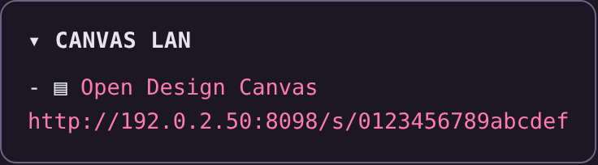
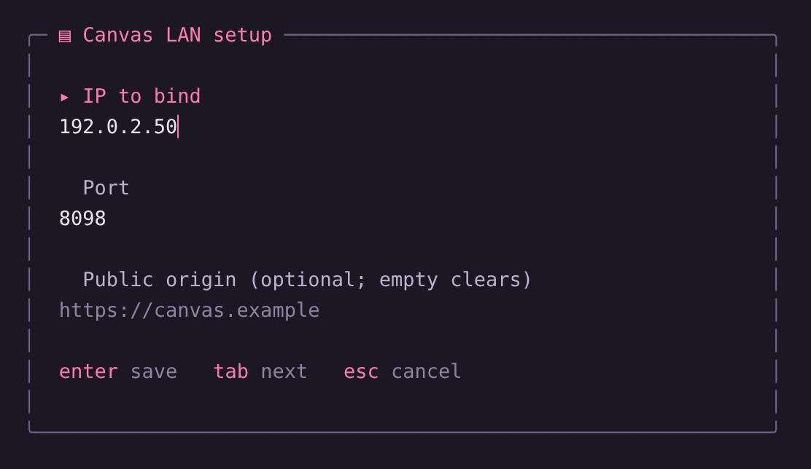

# Gentle Canvas LAN

Open the Gentle Design canvas from your phone or laptop on the same network while
[Gentle Shell](https://github.com/Gentleman-Programming/gentle-shell) runs on a headless machine.
No tunnels, no Tailscale, one stable address.

<p align="center">
  
</p>

## What it does

- Keeps **one fixed LAN address** for a canvas whose real port and token change every time you reopen it.
- Shows a **short, stable link** (`http://LAN_IP:PORT/s/<16-hex>`) in the sidebar card that redirects to the current canvas. The full tokenized URL is still printed by `/canvas-lan:status` and in tool output.
- Proxies the canvas over the LAN with guarded upstream forwarding: exact Host/Origin rules, token paths, SSE streaming, and no forwarded-header trust.
- **Never advertises a dead link.** The registration is probed before a link is shown; a canvas that stopped answering is revoked.
- **Explains an empty port.** With nothing live, a request shows a short page saying the canvas is not running instead of a bare `Bad Gateway`.

## Requirements

- [Gentle Shell](https://github.com/Gentleman-Programming/gentle-shell) (`gentle-pi`) and Node.js 22+.
- Gentle Design running in that session — the canvas it serves locally is what gets exposed.
- The other device on the same trusted network.

## Install

```sh
pi install npm:@ghosthvj/gentle-canvas-lan
```

From a git checkout instead:

```sh
pi install git:github.com/ghosthvj/gentle-canvas-lan
```

To try it once without touching your settings: `pi -e npm:@ghosthvj/gentle-canvas-lan`.

## Configure

Run `/canvas-lan:setup`.

<p align="center">
  
</p>

It writes `~/.config/gentle-canvas-lan/config.json` (mode `0600`, atomic replace) and rebuilds the proxy. The two optional caps can also be saved there as plain JSON keys, e.g. `{ "ip": "192.168.1.20", "port": "34316", "maxBodyBytes": "10485760" }`.

| Setting | Environment variable | Notes |
| --- | --- | --- |
| Bind IP | `GENTLE_CANVAS_LAN_IP` | Required. A concrete IPv4/IPv6 address of this host, never `0.0.0.0`, `::` or a hostname. |
| Port | `GENTLE_CANVAS_LAN_PORT` | Defaults to `34316`. |
| Public origin | `GENTLE_CANVAS_LAN_PUBLIC_ORIGIN` | Optional exact `http(s)://host[:port]` origin when a reverse proxy terminates TLS. |
| Max body size | `GENTLE_CANVAS_LAN_MAX_BODY_BYTES` | Optional cap in bytes for request bodies forwarded to the canvas. Defaults to `52428800` (50 MB). |
| Max connections | `GENTLE_CANVAS_LAN_MAX_CONNECTIONS` | Optional cap on concurrent client connections. Defaults to `64`. |

Environment variables win per key over saved values.

## Commands

<table>
<thead>
<tr><th width="230" align="left">Command</th><th align="left">What it does</th></tr>
</thead>
<tbody>
<tr><td width="230"><code>/canvas-lan:setup</code></td><td>Configure the bind IP, port and optional public origin.</td></tr>
<tr><td width="230"><code>/canvas-lan:start</code></td><td>Enable the listener. The card appears only while the registered canvas answers.</td></tr>
<tr><td width="230"><code>/canvas-lan:status</code></td><td>Show the effective IP and port with their source (<code>env</code>/<code>saved</code>), the listener state and the current LAN link.</td></tr>
<tr><td width="230"><code>/canvas-lan:stop</code></td><td>Stop listening and disable automatic start until you start it again.</td></tr>
</tbody>
</table>

In the TUI, command results and errors stay in the transcript instead of the one-line status slot that the next notification would replace.

## Troubleshooting

- **The browser shows "Gentle Design canvas is not running".** The port is still reserved but the local canvas stopped. Open a design in Gentle Shell and reload the page.
- **No card, and `status` says the proxy is running with no URL.** There is no live canvas registration yet; opening a design registers it and starts the listener.
- **Port already in use.** Pick another port in `/canvas-lan:setup`; a conflict is reported without killing the other process.

## Security

Traffic is plain HTTP and there is no authentication. Tokenized URLs and the short link are **capabilities**: anyone on your network who has one can view the canvas and send comments to the agent. Use it only on a trusted network, never forward the port to the internet, and stop the listener when you are done.

## Docs

[Configuration](docs/configuration.md) · [Public origin trust](docs/public-origin.md) · [Proxy](docs/proxy.md) · [Controller](docs/controller.md) · [Sidebar adapter](docs/sidebar-adapter.md) · [Card](docs/lan-panel.md) · [Changelog](CHANGELOG.md)

## License

MIT. See [LICENSE](LICENSE) and [THIRD_PARTY_NOTICES.md](THIRD_PARTY_NOTICES.md) for the upstream attribution.

<p align="center">
  <a href="https://github.com/Gentleman-Programming/gentle-ai">
    
  </a>
</p>
